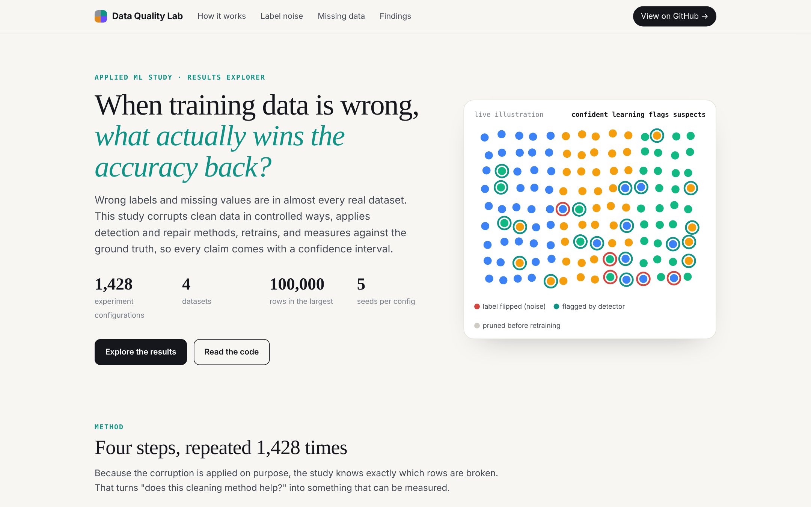
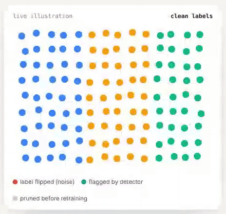
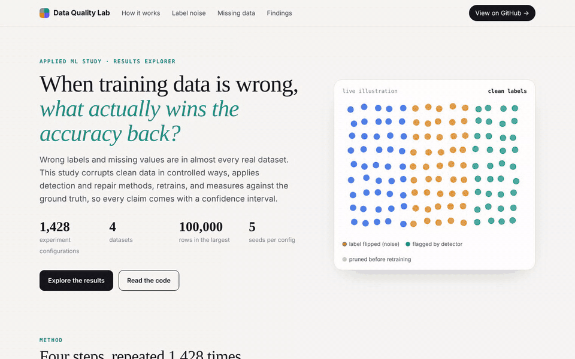
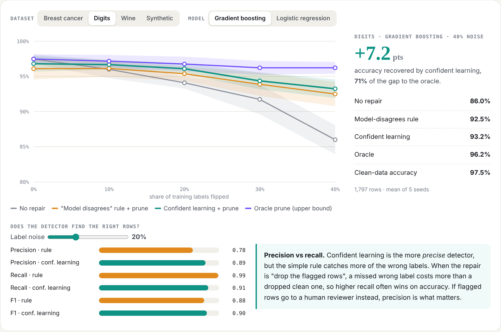
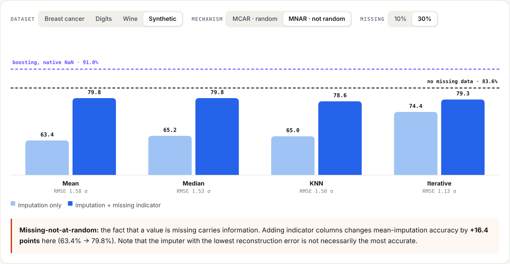
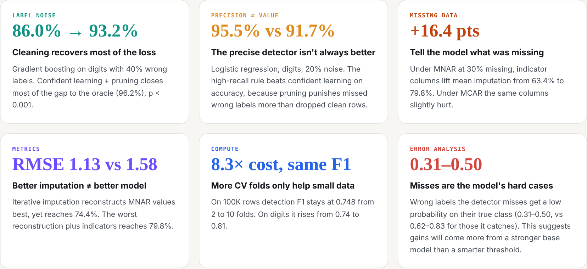
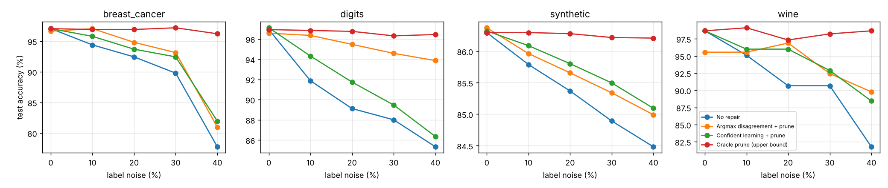
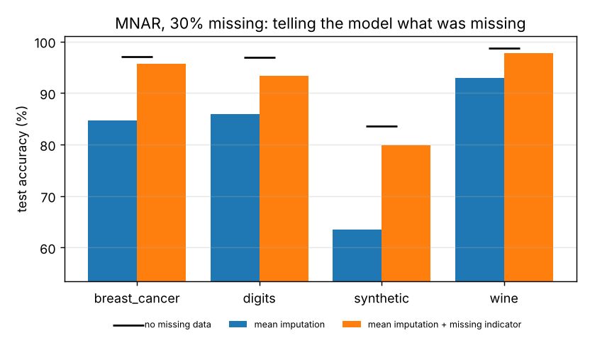

# Data Quality Lab


**How much do wrong labels and missing values hurt a machine learning model, and which repairs
actually win the accuracy back?** This project answers that with a controlled experiment: break
clean data in known ways, apply detection and repair methods, retrain, and measure against the
ground truth. 1,428 experiment configurations, 4 datasets (up to 100,000 rows), 2 model families,
5 random seeds, and every number reported with a 95% confidence interval.

**[▶ Open the interactive results explorer](https://padu28.github.io/data-quality-lab/)** ·
[Full results report](results/REPORT.md) · [Code](dqlab/)



---

## Contents

1. [Why this matters](#why-this-matters)
2. [The interactive explorer](#the-interactive-explorer)
3. [How the study works](#how-the-study-works)
4. [Key terms in plain words](#key-terms-in-plain-words)
5. [Results: six findings](#results-six-findings)
6. [Project structure](#project-structure)
7. [Run it yourself](#run-it-yourself)
8. [Design decisions](#design-decisions)
9. [Limitations and next steps](#limitations-and-next-steps)

## Why this matters

Real training data is messy. Annotators make mistakes, so some labels are wrong. Sensors fail and
forms get skipped, so some values are missing. Teams usually respond with a cleaning step, such as
"drop suspicious rows" or "fill in the blanks", without measuring whether it helps. Measuring it is
hard on real data, because nobody knows which labels are actually wrong.

This project gets around that by starting from **clean** data and corrupting it **on purpose**.
Because the study knows exactly which rows were broken, it can score every detection method
(did it find the broken rows?) and every repair (did accuracy come back?) against the truth.

## The interactive explorer

The results are published as an interactive page: **https://padu28.github.io/data-quality-lab/**.
It is one self-contained HTML file with no frameworks or chart libraries, generated from the raw
result CSVs by [`site/build_site.py`](site/build_site.py).

| | |
|---|---|
|  | **Animated illustration (top of the page).** A grid of data points in three classes. 20% of labels get flipped (red rings), the detector flags suspects (teal rings, including a few false alarms on clean points), and flagged rows are pruned before retraining. Missed wrong labels stay red, just as in the real results. |

**Explore the charts.** Pick a dataset and a model, and the chart redraws with the measured accuracy
of each repair method, its confidence band, and a summary of how much accuracy was recovered.
A slider shows each detector's precision and recall at each noise level. The missing-data chart
switches between imputers, missingness types and rates.



<details>
<summary><b>Static screenshots of each section</b></summary>

**Label noise: accuracy vs share of flipped labels, with detector precision and recall**


**Missing values: imputers with and without missing-indicator features**


**The six findings**

</details>

## How the study works

Every experiment configuration runs the same four steps:

| step | what happens | where in the code |
|---|---|---|
| **1. Corrupt** | Flip 0–40% of training labels to a different class, **or** blank 10–30% of cells. Missing cells are chosen either completely at random (MCAR) or with large values more likely to vanish (MNAR). A ground-truth mask records exactly what was broken. | [`dqlab/corrupt.py`](dqlab/corrupt.py) |
| **2. Detect** | Train with 5-fold cross-validation so every row gets a prediction from a model that never saw it (out-of-fold probabilities). Flag rows whose label looks wrong, with **confident learning** or a simple "model disagrees with the label" rule. | [`dqlab/detect.py`](dqlab/detect.py) |
| **3. Repair** | Labels: drop the flagged rows (never a whole class). Missing values: fill them with mean, median, KNN or iterative (MICE) imputation, optionally adding a 0/1 "was missing" column per feature. | [`dqlab/repair.py`](dqlab/repair.py) |
| **4. Evaluate** | Retrain and score on a test set that was **never corrupted**, so accuracy always means accuracy on true labels. Repeat over 5 seeds; report mean ± 95% CI and a paired t-test against doing nothing. | [`dqlab/experiments.py`](dqlab/experiments.py), [`dqlab/stats.py`](dqlab/stats.py) |

Two reference points frame every result: **no repair** (train on the broken data as-is) is the
floor, and an **oracle** that removes exactly the truly broken rows is the ceiling. A good method
closes as much of the gap between them as possible.

**Datasets.** `breast_cancer` (569 rows × 30 features), `digits` (1,797 × 64) and `wine`
(178 × 13) from scikit-learn, plus a 10-class synthetic problem with 40 features
(`make_classification`), used at 100,000 rows for logistic regression, 20,000 for gradient boosting
and 10,000 for the KNN-heavy imputation runs. Everything ships with scikit-learn, so the study runs
offline.

**Models.** Logistic regression (linear, with feature scaling) and histogram gradient boosting
(non-linear trees).

## Key terms in plain words

| term | meaning |
|---|---|
| **Label noise** | Training rows whose label is wrong, e.g. a "7" labelled as "1". |
| **Out-of-fold probability** | A prediction for a row made by a model trained on the *other* folds, so the model can't simply memorise the (possibly wrong) label. |
| **Confident learning** | A detection method ([Northcutt et al., 2021](https://arxiv.org/abs/1911.00068)). Each class gets its own confidence threshold (the model's average confidence on rows labelled with that class). A row is flagged when the model is confidently sure it belongs to a *different* class. Implemented from scratch here. |
| **Precision / recall (of a detector)** | Precision: of the rows flagged, how many were really wrong. Recall: of the rows that were really wrong, how many got flagged. |
| **MCAR / MNAR** | Missing Completely At Random (missingness is pure chance) vs Missing Not At Random (whether a value is missing depends on the value itself, e.g. high incomes left blank). |
| **Imputation** | Filling in missing values: with the column mean or median, from the 5 most similar rows (KNN), or by predicting each column from the others in rounds (iterative / MICE). |
| **Missing indicator** | An extra 0/1 column per feature saying "this value was missing", so the model can learn from the pattern of missingness itself. |
| **Oracle** | A cheat that knows the ground truth; shows the best any cleaning method could do. |
| **95% CI / paired t-test** | The uncertainty range of a mean across seeds, and a test of whether a method beats no repair on the same seeds. |

## Results: six findings

**1. Finding and removing mislabelled rows recovers most of the lost accuracy.**
With 40% of training labels flipped, gradient boosting on `digits` falls from 97.5% to 86.0%.
Confident-learning detection + pruning brings it back to **93.2%** (paired t-test p < 0.001). An
oracle that knows exactly which labels are wrong reaches 96.2%. On `breast_cancer` with 30% noise,
pruning lifts accuracy from 77.5% to **89.7%** (p = 0.002).



**2. The more precise detector is not always the better repair.** Confident learning flags rows
with much higher precision than the simple "model disagrees with the label" rule (0.88 vs 0.73 on
the 20,000-row synthetic set at 20% noise). But it also misses more of them (recall 0.78 vs 0.99).
When the repair is "drop the flagged rows", missing a wrong label costs more than dropping a clean
one, so the high-recall baseline often wins downstream: logistic regression on `digits` at 20% noise
reaches **95.5%** with the baseline vs 91.7% with confident learning. The right detector depends on
what you do with its output: prune → favour recall; send to human review → favour precision.

**3. When values are missing *because* of their value, the imputer matters less than telling the
model a value was missing.** Under missing-not-at-random (MNAR) data with 30% missing, mean
imputation drops the synthetic task's accuracy from 83.6% to 63.4%. Adding missing-indicator columns
recovers **79.8% (+16.4 points)**; on `breast_cancer` it goes from 84.6% to **95.7%**. Under
missing-completely-at-random data, the same indicators slightly *hurt* (e.g. `digits`, 30% MCAR:
89.9% → 87.6%), because they add 64 uninformative features. The fix depends on why data is missing.



**4. Lower imputation error does not mean higher accuracy.** On the synthetic set with 30% MNAR,
iterative imputation reconstructs the missing values best (RMSE 1.13 std devs vs 1.58 for mean
imputation), yet the model reaches only 74.4%. Mean imputation with missing indicators, the
*worst* reconstruction, reaches 79.8%. Imputation quality and task quality need to be measured
separately.

**5. More cross-validation folds help small datasets, not large ones.** For the detector's
out-of-fold probabilities, going from 2 to 10 folds raises detection F1 on `digits` from 0.74 to
0.82. On the 100,000-row synthetic set F1 stays at 0.748 while compute rises 8× (0.45 s → 3.75 s).

**6. What the detector misses is what the model finds hard.** Wrongly-labelled rows the detector
catches get a mean out-of-fold probability of 0.62–0.83 on their *true* class. The ones it misses
get only 0.31–0.50, so they are ambiguous examples where the model itself is unsure. False alarms
are clean rows whose correct label the model rates low (0.14–0.32). This suggests better detection will come more from a stronger base model than from a smarter threshold.

**Caveat:** pruning is not free. On clean data (0% noise) it removes hard but correct examples,
e.g. gradient boosting on `digits` drops from 97.5% to 96.1% with the baseline detector. Only prune
when there is reason to expect label noise.

## Project structure

```
dqlab/
  data.py           dataset loaders
  corrupt.py        label flipping, MCAR / MNAR masking (with ground-truth masks)
  detect.py         out-of-fold probabilities, model-disagrees rule, confident learning
  repair.py         pruning (never drops a whole class), imputers, missing indicators
  experiments.py    the four experiments: label noise, missing values, fold ablation, error analysis
  stats.py          confidence intervals, paired t-tests
run.py              runs every experiment, writes results/*.csv
report.py           CSVs → results/REPORT.md + matplotlib figures
site/
  build_site.py     CSVs → docs/index.html (the interactive explorer)
  template.html     explorer page: HTML, CSS and vanilla JS, no dependencies
docs/               GitHub Pages site + README images
results/            raw CSVs, REPORT.md, figures, run metadata
tests/              pytest unit tests; CI also runs the whole pipeline end to end
```

## Run it yourself

```bash
pip install -r requirements.txt
pytest                      # 20 unit tests, about 1 second
python run.py --quick       # smoke run of every experiment, about 2 minutes
python run.py               # full study, about 30 minutes on a 2-core machine
python report.py            # regenerate results/REPORT.md and figures from the CSVs
python site/build_site.py   # regenerate the interactive explorer (docs/index.html)
```

Open `docs/index.html` in a browser to view the explorer locally. Every number in this README, in
`REPORT.md` and in the explorer is computed from the raw CSVs in [`results/`](results/), so the
whole write-up can be regenerated and checked.

CI (GitHub Actions) runs the unit tests on Python 3.11 and 3.12, plus a quick end-to-end run of the
full pipeline, on every push and pull request.

## Design decisions

- **Controlled corruption instead of "real noisy data".** Without ground truth you can't tell a
  good detector from a lucky one. Synthetic corruption on real datasets gives both realism and
  measurability.
- **The test set is never corrupted** in label experiments, so a method can't look good by fitting
  the noise.
- **Out-of-fold detection.** Scoring rows with a model that trained on them would make wrong labels
  look correct. The fold-count ablation shows how many folds this needs.
- **Pruning never removes a whole class**, otherwise the retrained model could not predict it at all.
- **Seeds and paired tests.** Single runs on small datasets swing by several points, so each claim
  is a mean over seeds with a confidence interval, and comparisons use paired tests on matched seeds.
- **Report generated from data.** Tables, figures and the explorer are all produced by scripts from
  the CSVs, so no number is typed by hand.

## Limitations and next steps

- Noise is uniform (a flipped label goes to any other class). Real annotation errors are
  class-dependent (a 4 is mislabelled as a 9, rarely as a 0). Next: class-conditional noise
  matrices.
- Repairs are compared one at a time. Next: label noise and missing values together, as in real
  data.
- Re-weighting instead of pruning, and relabelling flagged rows with the model's prediction.
- A large real dataset (e.g. Forest Covertype, 581K rows; loader included in `dqlab/data.py`).
