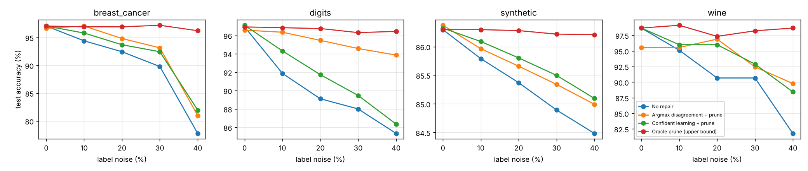
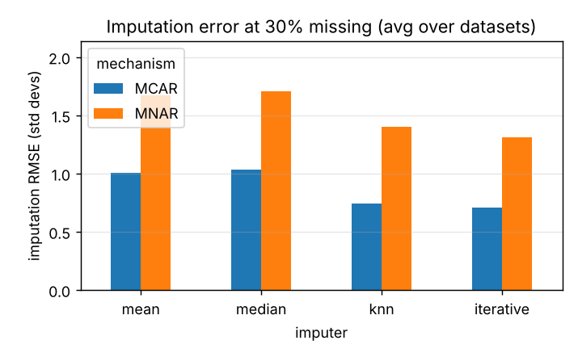
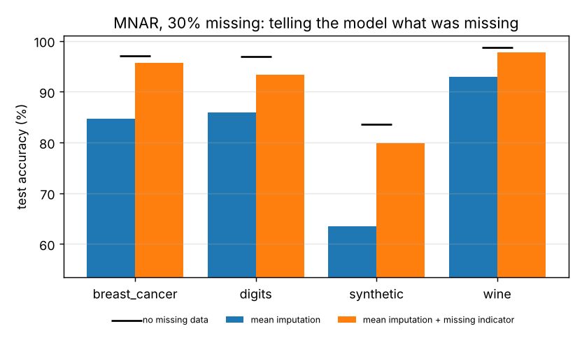
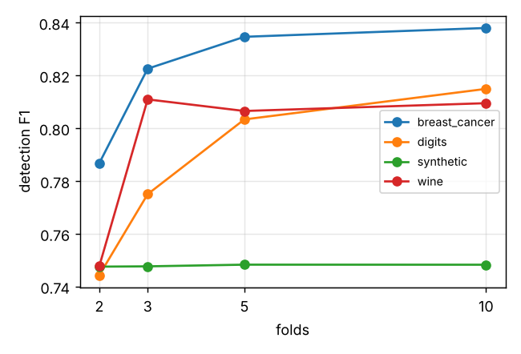

# Results

Generated by `report.py` from the CSVs in this folder. Config: **full**, seeds [0, 1, 2, 3, 4] (large dataset: [0, 1, 2]), scikit-learn 1.9.1, runtime 27.1 min.

## 1. Label noise: detect, prune, retrain

Test accuracy (%) on the clean test set, mean ± 95% CI across seeds. p = paired t-test of confident learning vs. no repair.

**breast_cancer · hgb**

| noise | No repair | Argmax disagreement + prune | Confident learning + prune | Oracle prune (upper bound) | p |
|---|---|---|---|---|---|
| 0% | 95.7 ± 1.7 | 95.0 ± 1.6 | 95.9 ± 2.2 | 95.7 ± 1.7 | – |
| 10% | 94.8 ± 1.8 | 95.2 ± 1.9 | 96.5 ± 1.2 | 95.9 ± 0.4 | 0.024 |
| 20% | 89.0 ± 3.0 | 94.8 ± 1.0 | 93.8 ± 1.7 | 96.5 ± 0.9 | 0.018 |
| 30% | 77.5 ± 3.9 | 89.5 ± 2.1 | 89.7 ± 3.6 | 94.5 ± 2.0 | 0.002 |
| 40% | 67.8 ± 5.5 | 79.6 ± 6.8 | 78.0 ± 5.7 | 95.2 ± 1.7 | 0.002 |

**digits · hgb**

| noise | No repair | Argmax disagreement + prune | Confident learning + prune | Oracle prune (upper bound) | p |
|---|---|---|---|---|---|
| 0% | 97.5 ± 0.7 | 96.1 ± 1.5 | 96.8 ± 1.1 | 97.5 ± 0.7 | – |
| 10% | 96.0 ± 1.2 | 96.1 ± 1.2 | 96.7 ± 0.7 | 97.2 ± 0.9 | 0.222 |
| 20% | 94.1 ± 0.8 | 95.4 ± 1.0 | 96.1 ± 0.8 | 96.8 ± 1.0 | 0.010 |
| 30% | 91.7 ± 2.1 | 93.9 ± 1.7 | 94.4 ± 1.2 | 96.2 ± 1.0 | 0.015 |
| 40% | 86.0 ± 2.1 | 92.5 ± 1.7 | 93.2 ± 1.3 | 96.2 ± 0.8 | 0.000 |

**synthetic · hgb**

| noise | No repair | Argmax disagreement + prune | Confident learning + prune | Oracle prune (upper bound) | p |
|---|---|---|---|---|---|
| 10% | 93.5 ± 1.3 | 94.3 ± 1.2 | 95.0 ± 1.0 | 95.6 ± 0.8 | 0.003 |
| 20% | 91.2 ± 1.0 | 93.5 ± 1.1 | 93.4 ± 0.9 | 95.4 ± 0.2 | 0.002 |
| 30% | 89.4 ± 0.4 | 93.0 ± 1.0 | 92.6 ± 1.8 | 94.9 ± 0.5 | 0.013 |
| 40% | 86.7 ± 1.6 | 91.9 ± 0.3 | 91.3 ± 1.1 | 94.8 ± 1.0 | 0.001 |

**wine · hgb**

| noise | No repair | Argmax disagreement + prune | Confident learning + prune | Oracle prune (upper bound) | p |
|---|---|---|---|---|---|
| 0% | 98.2 ± 3.6 | 98.2 ± 3.6 | 96.4 ± 3.7 | 98.2 ± 3.6 | – |
| 10% | 94.7 ± 4.2 | 97.8 ± 2.0 | 96.9 ± 3.7 | 98.2 ± 4.9 | 0.089 |
| 20% | 85.8 ± 6.9 | 94.7 ± 5.7 | 94.2 ± 4.2 | 99.1 ± 1.5 | 0.060 |
| 30% | 80.4 ± 5.3 | 90.7 ± 4.5 | 86.2 ± 4.5 | 98.2 ± 1.2 | 0.065 |
| 40% | 69.3 ± 5.7 | 83.1 ± 5.0 | 82.2 ± 7.0 | 97.8 ± 2.0 | 0.009 |

**breast_cancer · logreg**

| noise | No repair | Argmax disagreement + prune | Confident learning + prune | Oracle prune (upper bound) | p |
|---|---|---|---|---|---|
| 0% | 97.1 ± 1.3 | 96.6 ± 0.7 | 97.1 ± 0.7 | 97.1 ± 1.3 | – |
| 10% | 94.4 ± 1.4 | 97.1 ± 1.1 | 95.8 ± 1.8 | 96.9 ± 1.5 | 0.022 |
| 20% | 92.4 ± 2.4 | 94.8 ± 1.6 | 93.7 ± 1.9 | 96.9 ± 1.0 | 0.009 |
| 30% | 89.8 ± 4.9 | 93.1 ± 3.2 | 92.4 ± 4.1 | 97.2 ± 1.1 | 0.014 |
| 40% | 77.8 ± 6.7 | 81.0 ± 7.5 | 82.0 ± 8.7 | 96.2 ± 1.3 | 0.267 |

**digits · logreg**

| noise | No repair | Argmax disagreement + prune | Confident learning + prune | Oracle prune (upper bound) | p |
|---|---|---|---|---|---|
| 0% | 96.9 ± 1.6 | 96.6 ± 1.1 | 97.1 ± 0.7 | 96.9 ± 1.6 | – |
| 10% | 91.9 ± 0.9 | 96.4 ± 0.9 | 94.3 ± 1.5 | 96.8 ± 1.0 | 0.001 |
| 20% | 89.1 ± 1.4 | 95.5 ± 1.0 | 91.7 ± 1.0 | 96.8 ± 1.4 | 0.006 |
| 30% | 88.0 ± 2.8 | 94.6 ± 0.7 | 89.5 ± 2.8 | 96.3 ± 1.0 | 0.003 |
| 40% | 85.3 ± 3.0 | 93.9 ± 1.4 | 86.4 ± 2.6 | 96.4 ± 0.6 | 0.056 |

**synthetic · logreg**

| noise | No repair | Argmax disagreement + prune | Confident learning + prune | Oracle prune (upper bound) | p |
|---|---|---|---|---|---|
| 0% | 86.3 ± 0.7 | 86.4 ± 0.6 | 86.3 ± 0.6 | 86.3 ± 0.7 | – |
| 10% | 85.8 ± 0.6 | 86.0 ± 0.7 | 86.1 ± 0.6 | 86.3 ± 0.7 | 0.052 |
| 20% | 85.4 ± 0.4 | 85.7 ± 0.4 | 85.8 ± 0.7 | 86.3 ± 0.8 | 0.022 |
| 30% | 84.9 ± 0.6 | 85.3 ± 0.6 | 85.5 ± 0.5 | 86.2 ± 0.7 | 0.003 |
| 40% | 84.5 ± 0.3 | 85.0 ± 0.2 | 85.1 ± 0.2 | 86.2 ± 0.7 | 0.001 |

**wine · logreg**

| noise | No repair | Argmax disagreement + prune | Confident learning + prune | Oracle prune (upper bound) | p |
|---|---|---|---|---|---|
| 0% | 98.7 ± 1.5 | 95.6 ± 2.0 | 98.7 ± 1.5 | 98.7 ± 1.5 | – |
| 10% | 95.1 ± 4.1 | 95.6 ± 5.2 | 96.0 ± 4.5 | 99.1 ± 1.5 | 0.670 |
| 20% | 90.7 ± 4.1 | 96.9 ± 2.5 | 96.0 ± 5.3 | 97.3 ± 2.3 | 0.042 |
| 30% | 90.7 ± 8.6 | 92.4 ± 9.3 | 92.9 ± 8.4 | 98.2 ± 2.3 | 0.374 |
| 40% | 81.8 ± 5.3 | 89.8 ± 11.5 | 88.4 ± 14.0 | 98.7 ± 1.5 | 0.164 |

### Detection quality (does the detector find the right rows?)

| model | dataset | noise | detector | precision | recall | F1 |
|---|---|---|---|---|---|---|
| hgb | breast_cancer | 10% | Argmax disagreement | 0.626 ± 0.077 | 0.967 ± 0.048 | 0.759 ± 0.068 |
| hgb | breast_cancer | 10% | Confident learning | 0.809 ± 0.059 | 0.879 ± 0.032 | 0.842 ± 0.043 |
| hgb | breast_cancer | 20% | Argmax disagreement | 0.655 ± 0.063 | 0.856 ± 0.026 | 0.742 ± 0.043 |
| hgb | breast_cancer | 20% | Confident learning | 0.747 ± 0.043 | 0.748 ± 0.066 | 0.746 ± 0.026 |
| hgb | breast_cancer | 30% | Argmax disagreement | 0.606 ± 0.032 | 0.806 ± 0.035 | 0.691 ± 0.018 |
| hgb | breast_cancer | 30% | Confident learning | 0.635 ± 0.040 | 0.752 ± 0.072 | 0.687 ± 0.034 |
| hgb | breast_cancer | 40% | Argmax disagreement | 0.576 ± 0.024 | 0.685 ± 0.039 | 0.626 ± 0.027 |
| hgb | breast_cancer | 40% | Confident learning | 0.565 ± 0.025 | 0.655 ± 0.045 | 0.606 ± 0.022 |
| hgb | digits | 10% | Argmax disagreement | 0.720 ± 0.040 | 0.997 ± 0.005 | 0.836 ± 0.028 |
| hgb | digits | 10% | Confident learning | 0.899 ± 0.029 | 0.936 ± 0.037 | 0.917 ± 0.026 |
| hgb | digits | 20% | Argmax disagreement | 0.781 ± 0.021 | 0.994 ± 0.007 | 0.875 ± 0.011 |
| hgb | digits | 20% | Confident learning | 0.888 ± 0.024 | 0.910 ± 0.031 | 0.899 ± 0.017 |
| hgb | digits | 30% | Argmax disagreement | 0.802 ± 0.015 | 0.989 ± 0.004 | 0.885 ± 0.011 |
| hgb | digits | 30% | Confident learning | 0.867 ± 0.008 | 0.900 ± 0.014 | 0.883 ± 0.010 |
| hgb | digits | 40% | Argmax disagreement | 0.801 ± 0.020 | 0.982 ± 0.005 | 0.882 ± 0.013 |
| hgb | digits | 40% | Confident learning | 0.836 ± 0.017 | 0.921 ± 0.012 | 0.877 ± 0.009 |
| hgb | synthetic | 10% | Argmax disagreement | 0.617 ± 0.018 | 0.992 ± 0.001 | 0.761 ± 0.014 |
| hgb | synthetic | 10% | Confident learning | 0.833 ± 0.009 | 0.798 ± 0.018 | 0.815 ± 0.013 |
| hgb | synthetic | 20% | Argmax disagreement | 0.725 ± 0.031 | 0.991 ± 0.003 | 0.837 ± 0.021 |
| hgb | synthetic | 20% | Confident learning | 0.884 ± 0.019 | 0.780 ± 0.021 | 0.829 ± 0.009 |
| hgb | synthetic | 30% | Argmax disagreement | 0.786 ± 0.006 | 0.989 ± 0.001 | 0.876 ± 0.003 |
| hgb | synthetic | 30% | Confident learning | 0.895 ± 0.007 | 0.789 ± 0.010 | 0.839 ± 0.009 |
| hgb | synthetic | 40% | Argmax disagreement | 0.813 ± 0.003 | 0.985 ± 0.004 | 0.891 ± 0.003 |
| hgb | synthetic | 40% | Confident learning | 0.890 ± 0.005 | 0.820 ± 0.016 | 0.853 ± 0.008 |
| hgb | wine | 10% | Argmax disagreement | 0.485 ± 0.123 | 0.954 ± 0.052 | 0.639 ± 0.116 |
| hgb | wine | 10% | Confident learning | 0.592 ± 0.129 | 0.846 ± 0.068 | 0.694 ± 0.109 |
| hgb | wine | 20% | Argmax disagreement | 0.616 ± 0.062 | 0.926 ± 0.098 | 0.738 ± 0.057 |
| hgb | wine | 20% | Confident learning | 0.691 ± 0.081 | 0.822 ± 0.082 | 0.748 ± 0.059 |
| hgb | wine | 30% | Argmax disagreement | 0.614 ± 0.085 | 0.880 ± 0.071 | 0.721 ± 0.069 |
| hgb | wine | 30% | Confident learning | 0.657 ± 0.146 | 0.780 ± 0.141 | 0.706 ± 0.092 |
| hgb | wine | 40% | Argmax disagreement | 0.619 ± 0.046 | 0.868 ± 0.060 | 0.722 ± 0.047 |
| hgb | wine | 40% | Confident learning | 0.628 ± 0.054 | 0.849 ± 0.068 | 0.721 ± 0.053 |
| logreg | breast_cancer | 10% | Argmax disagreement | 0.687 ± 0.056 | 0.949 ± 0.047 | 0.796 ± 0.030 |
| logreg | breast_cancer | 10% | Confident learning | 0.921 ± 0.076 | 0.726 ± 0.047 | 0.810 ± 0.042 |
| logreg | breast_cancer | 20% | Argmax disagreement | 0.751 ± 0.050 | 0.906 ± 0.052 | 0.821 ± 0.048 |
| logreg | breast_cancer | 20% | Confident learning | 0.891 ± 0.035 | 0.704 ± 0.095 | 0.785 ± 0.073 |
| logreg | breast_cancer | 30% | Argmax disagreement | 0.732 ± 0.070 | 0.869 ± 0.073 | 0.794 ± 0.064 |
| logreg | breast_cancer | 30% | Confident learning | 0.787 ± 0.082 | 0.755 ± 0.099 | 0.769 ± 0.078 |
| logreg | breast_cancer | 40% | Argmax disagreement | 0.629 ± 0.064 | 0.733 ± 0.070 | 0.677 ± 0.064 |
| logreg | breast_cancer | 40% | Confident learning | 0.624 ± 0.067 | 0.706 ± 0.093 | 0.662 ± 0.076 |
| logreg | digits | 10% | Argmax disagreement | 0.530 ± 0.031 | 0.996 ± 0.008 | 0.691 ± 0.027 |
| logreg | digits | 10% | Confident learning | 0.803 ± 0.037 | 0.769 ± 0.063 | 0.785 ± 0.039 |
| logreg | digits | 20% | Argmax disagreement | 0.660 ± 0.017 | 0.990 ± 0.010 | 0.792 ± 0.013 |
| logreg | digits | 20% | Confident learning | 0.820 ± 0.025 | 0.783 ± 0.036 | 0.801 ± 0.026 |
| logreg | digits | 30% | Argmax disagreement | 0.735 ± 0.010 | 0.978 ± 0.007 | 0.840 ± 0.007 |
| logreg | digits | 30% | Confident learning | 0.820 ± 0.013 | 0.809 ± 0.029 | 0.814 ± 0.013 |
| logreg | digits | 40% | Argmax disagreement | 0.783 ± 0.018 | 0.979 ± 0.008 | 0.870 ± 0.012 |
| logreg | digits | 40% | Confident learning | 0.835 ± 0.020 | 0.863 ± 0.022 | 0.848 ± 0.011 |
| logreg | synthetic | 10% | Argmax disagreement | 0.433 ± 0.003 | 0.983 ± 0.002 | 0.601 ± 0.002 |
| logreg | synthetic | 10% | Confident learning | 0.646 ± 0.009 | 0.685 ± 0.006 | 0.665 ± 0.006 |
| logreg | synthetic | 20% | Argmax disagreement | 0.624 ± 0.004 | 0.984 ± 0.002 | 0.763 ± 0.003 |
| logreg | synthetic | 20% | Confident learning | 0.763 ± 0.004 | 0.736 ± 0.008 | 0.749 ± 0.002 |
| logreg | synthetic | 30% | Argmax disagreement | 0.735 ± 0.005 | 0.985 ± 0.003 | 0.842 ± 0.002 |
| logreg | synthetic | 30% | Confident learning | 0.813 ± 0.001 | 0.802 ± 0.012 | 0.808 ± 0.005 |
| logreg | synthetic | 40% | Argmax disagreement | 0.807 ± 0.003 | 0.983 ± 0.003 | 0.887 ± 0.003 |
| logreg | synthetic | 40% | Confident learning | 0.848 ± 0.007 | 0.872 ± 0.009 | 0.860 ± 0.008 |
| logreg | wine | 10% | Argmax disagreement | 0.571 ± 0.055 | 0.969 ± 0.085 | 0.717 ± 0.050 |
| logreg | wine | 10% | Confident learning | 0.791 ± 0.078 | 0.862 ± 0.196 | 0.819 ± 0.113 |
| logreg | wine | 20% | Argmax disagreement | 0.726 ± 0.056 | 0.970 ± 0.038 | 0.830 ± 0.044 |
| logreg | wine | 20% | Confident learning | 0.892 ± 0.061 | 0.807 ± 0.115 | 0.847 ± 0.087 |
| logreg | wine | 30% | Argmax disagreement | 0.690 ± 0.031 | 0.945 ± 0.074 | 0.797 ± 0.040 |
| logreg | wine | 30% | Confident learning | 0.772 ± 0.080 | 0.855 ± 0.099 | 0.810 ± 0.078 |
| logreg | wine | 40% | Argmax disagreement | 0.752 ± 0.033 | 0.883 ± 0.067 | 0.812 ± 0.043 |
| logreg | wine | 40% | Confident learning | 0.792 ± 0.062 | 0.838 ± 0.103 | 0.814 ± 0.077 |

## 2. Missing values: which imputer, and does a missing-indicator help?

Logistic regression test accuracy (%) and imputation RMSE (in standard deviations, on masked training cells). HGB with native NaN handling is shown as a no-imputation reference.

**breast_cancer · MCAR · 10% missing** (clean accuracy 97.1%)

| imputer | accuracy | + indicator | RMSE |
|---|---|---|---|
| mean | 96.8 ± 1.8 | 96.4 ± 1.1 | 1.003 ± 0.050 |
| median | 96.9 ± 1.5 | 96.2 ± 1.3 | 1.027 ± 0.059 |
| knn | 96.8 ± 1.3 | 96.2 ± 1.8 | 0.566 ± 0.051 |
| iterative | 97.1 ± 1.3 | 96.2 ± 0.8 | 0.348 ± 0.057 |
| HGB native NaN | 94.5 ± 2.3 | – | – |

**breast_cancer · MCAR · 30% missing** (clean accuracy 97.1%)

| imputer | accuracy | + indicator | RMSE |
|---|---|---|---|
| mean | 95.8 ± 1.4 | 95.0 ± 2.1 | 1.000 ± 0.025 |
| median | 95.5 ± 1.5 | 95.0 ± 2.1 | 1.028 ± 0.029 |
| knn | 95.9 ± 1.0 | 95.4 ± 1.7 | 0.629 ± 0.025 |
| iterative | 96.5 ± 1.6 | 95.5 ± 1.3 | 0.441 ± 0.019 |
| HGB native NaN | 95.1 ± 2.7 | – | – |

**breast_cancer · MNAR · 10% missing** (clean accuracy 97.1%)

| imputer | accuracy | + indicator | RMSE |
|---|---|---|---|
| mean | 96.9 ± 2.5 | 96.4 ± 1.9 | 1.587 ± 0.045 |
| median | 96.2 ± 2.3 | 96.2 ± 2.2 | 1.738 ± 0.042 |
| knn | 96.8 ± 1.6 | 96.2 ± 1.3 | 0.934 ± 0.037 |
| iterative | 97.3 ± 1.7 | 96.5 ± 1.4 | 0.590 ± 0.050 |
| HGB native NaN | 94.8 ± 2.6 | – | – |

**breast_cancer · MNAR · 30% missing** (clean accuracy 97.1%)

| imputer | accuracy | + indicator | RMSE |
|---|---|---|---|
| mean | 84.6 ± 3.1 | 95.7 ± 1.6 | 1.800 ± 0.006 |
| median | 83.5 ± 4.1 | 95.4 ± 1.3 | 1.852 ± 0.005 |
| knn | 92.6 ± 2.3 | 95.0 ± 1.0 | 1.461 ± 0.017 |
| iterative | 93.6 ± 1.1 | 95.0 ± 0.7 | 1.386 ± 0.014 |
| HGB native NaN | 95.5 ± 1.6 | – | – |

**digits · MCAR · 10% missing** (clean accuracy 96.9%)

| imputer | accuracy | + indicator | RMSE |
|---|---|---|---|
| mean | 94.7 ± 1.2 | 93.3 ± 0.9 | 0.978 ± 0.041 |
| median | 94.6 ± 1.4 | 93.5 ± 0.8 | 1.027 ± 0.037 |
| knn | 96.2 ± 0.8 | 95.2 ± 0.8 | 0.624 ± 0.071 |
| iterative | 95.9 ± 1.2 | 94.4 ± 0.6 | 0.867 ± 0.143 |
| HGB native NaN | 95.8 ± 1.1 | – | – |

**digits · MCAR · 30% missing** (clean accuracy 96.9%)

| imputer | accuracy | + indicator | RMSE |
|---|---|---|---|
| mean | 89.9 ± 1.2 | 87.6 ± 2.3 | 0.995 ± 0.033 |
| median | 89.5 ± 1.9 | 87.6 ± 2.2 | 1.045 ± 0.032 |
| knn | 94.2 ± 1.4 | 92.4 ± 1.2 | 0.699 ± 0.046 |
| iterative | 93.0 ± 0.7 | 89.5 ± 0.9 | 0.781 ± 0.038 |
| HGB native NaN | 92.8 ± 2.0 | – | – |

**digits · MNAR · 10% missing** (clean accuracy 96.9%)

| imputer | accuracy | + indicator | RMSE |
|---|---|---|---|
| mean | 94.7 ± 1.6 | 94.8 ± 1.0 | 1.487 ± 0.048 |
| median | 93.7 ± 1.8 | 94.8 ± 1.0 | 1.605 ± 0.049 |
| knn | 96.2 ± 0.9 | 95.2 ± 1.4 | 1.001 ± 0.061 |
| iterative | 96.0 ± 0.5 | 94.5 ± 1.3 | 1.139 ± 0.190 |
| HGB native NaN | 96.5 ± 0.5 | – | – |

**digits · MNAR · 30% missing** (clean accuracy 96.9%)

| imputer | accuracy | + indicator | RMSE |
|---|---|---|---|
| mean | 85.9 ± 1.9 | 93.4 ± 2.1 | 1.616 ± 0.013 |
| median | 82.4 ± 1.4 | 93.0 ± 2.9 | 1.705 ± 0.014 |
| knn | 88.6 ± 1.0 | 93.3 ± 1.5 | 1.354 ± 0.022 |
| iterative | 89.4 ± 1.1 | 92.4 ± 2.4 | 1.328 ± 0.017 |
| HGB native NaN | 95.9 ± 1.1 | – | – |

**synthetic · MCAR · 10% missing** (clean accuracy 83.6%)

| imputer | accuracy | + indicator | RMSE |
|---|---|---|---|
| mean | 80.0 ± 1.1 | 79.9 ± 1.6 | 0.997 ± 0.003 |
| median | 79.9 ± 1.2 | 79.9 ± 1.7 | 0.998 ± 0.003 |
| knn | 82.7 ± 0.1 | 82.0 ± 0.2 | 0.803 ± 0.001 |
| iterative | 83.6 ± 0.2 | 82.9 ± 0.8 | 0.511 ± 0.008 |
| HGB native NaN | 91.0 ± 0.6 | – | – |

**synthetic · MCAR · 30% missing** (clean accuracy 83.6%)

| imputer | accuracy | + indicator | RMSE |
|---|---|---|---|
| mean | 73.3 ± 1.7 | 72.7 ± 1.5 | 0.999 ± 0.004 |
| median | 73.5 ± 1.7 | 72.7 ± 1.4 | 0.999 ± 0.004 |
| knn | 77.9 ± 1.1 | 76.6 ± 2.5 | 0.884 ± 0.003 |
| iterative | 79.3 ± 0.9 | 78.7 ± 0.8 | 0.706 ± 0.036 |
| HGB native NaN | 82.2 ± 2.1 | – | – |

**synthetic · MNAR · 10% missing** (clean accuracy 83.6%)

| imputer | accuracy | + indicator | RMSE |
|---|---|---|---|
| mean | 78.8 ± 0.5 | 82.0 ± 1.1 | 1.340 ± 0.006 |
| median | 78.9 ± 0.5 | 82.0 ± 1.0 | 1.340 ± 0.005 |
| knn | 82.5 ± 0.6 | 82.9 ± 0.9 | 1.039 ± 0.009 |
| iterative | 83.6 ± 0.3 | 82.7 ± 1.3 | 0.689 ± 0.009 |
| HGB native NaN | 92.3 ± 1.3 | – | – |

**synthetic · MNAR · 30% missing** (clean accuracy 83.6%)

| imputer | accuracy | + indicator | RMSE |
|---|---|---|---|
| mean | 63.4 ± 1.0 | 79.8 ± 1.8 | 1.580 ± 0.002 |
| median | 65.2 ± 1.4 | 79.8 ± 1.8 | 1.530 ± 0.003 |
| knn | 65.0 ± 1.8 | 78.6 ± 0.7 | 1.495 ± 0.003 |
| iterative | 74.4 ± 1.3 | 79.3 ± 1.3 | 1.131 ± 0.002 |
| HGB native NaN | 91.0 ± 0.7 | – | – |

**wine · MCAR · 10% missing** (clean accuracy 98.7%)

| imputer | accuracy | + indicator | RMSE |
|---|---|---|---|
| mean | 98.2 ± 2.3 | 95.6 ± 2.8 | 0.991 ± 0.038 |
| median | 96.9 ± 3.1 | 95.1 ± 3.6 | 1.010 ± 0.044 |
| knn | 99.1 ± 1.5 | 97.8 ± 2.8 | 0.741 ± 0.103 |
| iterative | 98.2 ± 2.3 | 96.4 ± 2.5 | 0.738 ± 0.058 |
| HGB native NaN | 95.1 ± 7.4 | – | – |

**wine · MCAR · 30% missing** (clean accuracy 98.7%)

| imputer | accuracy | + indicator | RMSE |
|---|---|---|---|
| mean | 94.2 ± 4.2 | 90.7 ± 2.3 | 1.021 ± 0.033 |
| median | 95.1 ± 3.0 | 91.1 ± 2.0 | 1.041 ± 0.037 |
| knn | 96.0 ± 4.1 | 95.1 ± 5.3 | 0.803 ± 0.037 |
| iterative | 91.6 ± 4.1 | 90.7 ± 4.9 | 0.911 ± 0.046 |
| HGB native NaN | 93.3 ± 3.9 | – | – |

**wine · MNAR · 10% missing** (clean accuracy 98.7%)

| imputer | accuracy | + indicator | RMSE |
|---|---|---|---|
| mean | 98.2 ± 2.3 | 98.7 ± 2.5 | 1.381 ± 0.032 |
| median | 98.7 ± 1.5 | 98.7 ± 2.5 | 1.457 ± 0.022 |
| knn | 99.6 ± 1.2 | 99.1 ± 2.5 | 0.963 ± 0.034 |
| iterative | 99.1 ± 1.5 | 99.1 ± 1.5 | 0.964 ± 0.051 |
| HGB native NaN | 97.8 ± 3.4 | – | – |

**wine · MNAR · 30% missing** (clean accuracy 98.7%)

| imputer | accuracy | + indicator | RMSE |
|---|---|---|---|
| mean | 92.9 ± 3.6 | 97.8 ± 2.0 | 1.645 ± 0.012 |
| median | 92.0 ± 3.1 | 97.8 ± 2.0 | 1.671 ± 0.007 |
| knn | 92.9 ± 4.1 | 96.4 ± 1.5 | 1.327 ± 0.030 |
| iterative | 95.1 ± 4.1 | 96.4 ± 1.5 | 1.329 ± 0.032 |
| HGB native NaN | 97.3 ± 3.6 | – | – |

## 3. Ablation: number of cross-validation folds for the detector

| dataset | folds | precision | recall | F1 | prune → accuracy (%) | seconds |
|---|---|---|---|---|---|---|
| breast_cancer | 2 | 0.829 ± 0.125 | 0.753 ± 0.095 | 0.787 ± 0.089 | 93.1 ± 4.0 | 0.01 |
| breast_cancer | 3 | 0.879 ± 0.090 | 0.774 ± 0.074 | 0.823 ± 0.075 | 95.0 ± 4.1 | 0.02 |
| breast_cancer | 5 | 0.891 ± 0.091 | 0.786 ± 0.090 | 0.835 ± 0.085 | 93.7 ± 4.2 | 0.04 |
| breast_cancer | 10 | 0.886 ± 0.080 | 0.795 ± 0.096 | 0.838 ± 0.086 | 94.4 ± 4.4 | 0.07 |
| digits | 2 | 0.723 ± 0.056 | 0.768 ± 0.011 | 0.744 ± 0.029 | 89.9 ± 2.2 | 0.04 |
| digits | 3 | 0.788 ± 0.033 | 0.763 ± 0.020 | 0.775 ± 0.019 | 91.5 ± 1.4 | 0.07 |
| digits | 5 | 0.833 ± 0.025 | 0.776 ± 0.026 | 0.803 ± 0.021 | 91.5 ± 1.9 | 0.12 |
| digits | 10 | 0.858 ± 0.018 | 0.776 ± 0.022 | 0.815 ± 0.015 | 91.5 ± 0.9 | 0.26 |
| synthetic | 2 | 0.762 ± 0.006 | 0.733 ± 0.005 | 0.748 ± 0.002 | 85.8 ± 0.8 | 0.45 |
| synthetic | 3 | 0.764 ± 0.004 | 0.733 ± 0.006 | 0.748 ± 0.002 | 85.8 ± 0.8 | 0.83 |
| synthetic | 5 | 0.764 ± 0.006 | 0.734 ± 0.007 | 0.748 ± 0.003 | 85.8 ± 0.8 | 1.72 |
| synthetic | 10 | 0.764 ± 0.004 | 0.733 ± 0.006 | 0.748 ± 0.003 | 85.8 ± 0.8 | 3.75 |
| wine | 2 | 0.721 ± 0.076 | 0.778 ± 0.065 | 0.748 ± 0.065 | 94.2 ± 4.6 | 0.01 |
| wine | 3 | 0.860 ± 0.112 | 0.778 ± 0.092 | 0.811 ± 0.039 | 94.2 ± 5.4 | 0.02 |
| wine | 5 | 0.865 ± 0.071 | 0.763 ± 0.095 | 0.807 ± 0.038 | 94.2 ± 3.1 | 0.02 |
| wine | 10 | 0.867 ± 0.066 | 0.770 ± 0.132 | 0.810 ± 0.059 | 94.2 ± 3.1 | 0.05 |

## 4. Error analysis (20% noise, logistic regression, seed 0)

Confidence profile: the out-of-fold probability the model gives the *given* (possibly wrong) label vs. the *true* label.

| dataset | group | rows | mean P(given label) | mean P(true label) |
|---|---|---|---|---|
| breast_cancer | caught (true positive) | 59 | 0.173 | 0.827 |
| breast_cancer | missed (false negative) | 26 | 0.557 | 0.443 |
| breast_cancer | false alarm (false positive) | 16 | 0.276 | 0.276 |
| breast_cancer | clean, not flagged | 325 | 0.757 | 0.757 |
| digits | caught (true positive) | 215 | 0.024 | 0.783 |
| digits | missed (false negative) | 54 | 0.113 | 0.353 |
| digits | false alarm (false positive) | 38 | 0.138 | 0.138 |
| digits | clean, not flagged | 1040 | 0.695 | 0.695 |
| wine | caught (true positive) | 17 | 0.086 | 0.824 |
| wine | missed (false negative) | 10 | 0.283 | 0.495 |
| wine | false alarm (false positive) | 1 | 0.322 | 0.322 |
| wine | clean, not flagged | 105 | 0.753 | 0.753 |
| synthetic | caught (true positive) | 11046 | 0.039 | 0.619 |
| synthetic | missed (false negative) | 3954 | 0.085 | 0.310 |
| synthetic | false alarm (false positive) | 3434 | 0.201 | 0.201 |
| synthetic | clean, not flagged | 56566 | 0.561 | 0.561 |

Hardest true classes (lowest recall of flipped labels, per dataset):

| dataset | true class | flipped | caught | recall |
|---|---|---|---|---|
| breast_cancer | 1 | 53 | 33 | 0.62 |
| breast_cancer | 0 | 32 | 26 | 0.81 |
| digits | 6 | 28 | 20 | 0.71 |
| digits | 1 | 34 | 25 | 0.74 |
| synthetic | 6 | 1536 | 1006 | 0.65 |
| synthetic | 1 | 1524 | 1028 | 0.67 |
| wine | 2 | 8 | 4 | 0.50 |
| wine | 0 | 6 | 4 | 0.67 |
